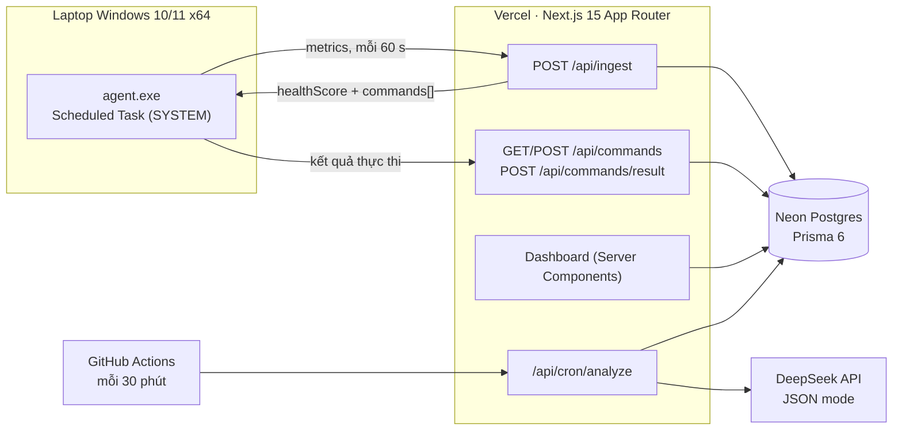

<div align="center">

# PC Trợ Lý AI

**Dashboard giám sát & bảo trì từ xa cho nhiều laptop Windows.**
Agent Python nhỏ gọn gửi telemetry về dashboard Next.js trên Vercel, rules engine cảnh báo sớm
theo ngưỡng tất định, còn DeepSeek AI giải thích nguyên nhân và đề xuất cách xử lý.

[](https://github.com/MindMachineAi/mma_pc_trolyai/actions/workflows/ci.yml)
[](https://github.com/MindMachineAi/mma_pc_trolyai/actions/workflows/security.yml)
[](LICENSE)
[](apps/web/package.json)
[](apps/web/package.json)
[](apps/web/tsconfig.json)
[](apps/web/prisma/schema.prisma)
[](package.json)
[](package.json)
[](apps/agent/requirements.txt)
[](docs/AGENT-INSTALL.md)

[Tính năng](#3-tính-năng) ·
[Bắt đầu nhanh](#6-bắt-đầu-nhanh) ·
[Cài agent](#7-cài-agent-trên-laptop) ·
[Triển khai](#8-triển-khai-production) ·
[Tài liệu](#tài-liệu)

</div>

---

## Mục lục

- [Tài liệu](#tài-liệu)
1. [Tổng quan](#1-tổng-quan)
2. [Kiến trúc](#2-kiến-trúc)
3. [Tính năng](#3-tính-năng)
4. [Ngăn xếp công nghệ](#4-ngăn-xếp-công-nghệ)
5. [Cấu trúc repo](#5-cấu-trúc-repo)
6. [Bắt đầu nhanh](#6-bắt-đầu-nhanh)
7. [Cài agent trên laptop](#7-cài-agent-trên-laptop)
8. [Triển khai production](#8-triển-khai-production)
9. [Biến môi trường](#9-biến-môi-trường)
10. [API](#10-api)
11. [Script](#11-script)
12. [Bảo mật](#12-bảo-mật)
13. [CI/CD](#13-cicd)
14. [Lộ trình](#14-lộ-trình)
15. [Giới hạn đã biết](#15-giới-hạn-đã-biết)
16. [Đóng góp và giấy phép](#16-đóng-góp-và-giấy-phép)

## Tài liệu

| Tài liệu | Nội dung |
| --- | --- |
| [docs/ARCHITECTURE.md](docs/ARCHITECTURE.md) | Thiết kế tầng, luồng dữ liệu, quyết định kỹ thuật |
| [docs/API.md](docs/API.md) | Đặc tả đầy đủ request/response của từng endpoint |
| [docs/DEPLOY.md](docs/DEPLOY.md) | Neon → Vercel → GitHub Actions, checklist bảo vệ repo |
| [docs/AGENT-INSTALL.md](docs/AGENT-INSTALL.md) | Cài, kiểm tra, gỡ agent trên laptop |
| [SECURITY.md](SECURITY.md) | Mô hình đe doạ & cách báo lỗ hổng |
| [CONTRIBUTING.md](CONTRIBUTING.md) | Quy trình đóng góp, lệnh kiểm thử cục bộ |

## 1. Tổng quan

Máy tính cá nhân (hoặc vài chiếc laptop trong nhà/cơ quan) thường chỉ được phát hiện "sắp hỏng"
khi đã quá muộn: ổ C: đầy, RAM tràn, pin chai, tản nhiệt bám bụi. **PC Trợ Lý AI** đặt một agent
nhỏ chạy nền trên từng máy, đẩy số liệu về một dashboard tập trung, và trả lời ba câu hỏi:

| Câu hỏi | Cách hệ thống trả lời |
| --- | --- |
| Máy nào đang có vấn đề? | Điểm sức khỏe 0–100 tính tất định + danh sách cảnh báo theo ngưỡng |
| Vì sao? | Rules engine chỉ ra chính xác ngưỡng bị vượt; AI tóm tắt nguyên nhân từ chuỗi số liệu |
| Làm gì bây giờ? | Đề xuất có mức rủi ro, gắn với lệnh bảo trì allowlist bấm một nút là chạy |

Nguyên tắc thiết kế: **phần quyết định phải rẻ và tất định** (rules + điểm sức khỏe chạy bằng code,
miễn phí, mỗi 60 giây), **AI chỉ là lớp giải thích** — không có AI thì dashboard vẫn đầy đủ chức năng.

> Repo công khai, nhưng **không chứa bất kỳ secret nào**. Toàn bộ khoá vận hành
> (`DATABASE_URL`, `AUTH_SECRET`, `DEEPSEEK_API_KEY`, `CRON_SECRET`, device token) chỉ tồn tại
> trong biến môi trường của người triển khai và trên từng máy — xem [SECURITY.md](SECURITY.md).

## 2. Kiến trúc



Một chu kỳ 60 giây của agent gồm đúng **một** request khứ hồi:

1. Agent thu thập số liệu bằng `psutil` (`collector.py`) — chỉ đọc, không can thiệp hệ thống.
2. `POST /api/ingest` (device token). Server ghi `Metric`, tính điểm sức khỏe, chạy rules engine
   (chống trùng cảnh báo 6 giờ), cập nhật `Device.lastSeenAt = now`.
3. Response mang luôn `healthScore`, các mã cảnh báo mới và **tối đa 5 lệnh đang chờ** (server
   chuyển chúng sang `SENT` ngay) — nhờ vậy không cần thêm một vòng poll riêng.
4. Agent thực thi từng lệnh qua allowlist rồi `POST /api/commands/result` với `DONE`/`FAILED`.
5. Cứ 10 phút (theo phút chia hết cho 10) server ghi thêm một `HealthSnapshot` để vẽ xu hướng.
6. DeepSeek chỉ được gọi từ `/api/cron/analyze` (Vercel Cron 1 lần/ngày + GitHub Actions 30 phút),
   không bao giờ nằm trên đường đi của ingest.

## 3. Tính năng

**Giám sát**

- Telemetry mỗi 60 giây (tối thiểu 15 giây): CPU, RAM, dung lượng & dung lượng trống ổ hệ thống,
  pin %, độ chai pin, uptime, số tiến trình, top tiến trình ngốn tài nguyên, nhiệt độ (nếu đọc được),
  lưu lượng mạng. Thông tin phần cứng (hostname, OS, CPU, GPU, RAM) gửi lần đầu và lặp lại mỗi 30 chu kỳ.
- Điểm sức khỏe 0–100 tính trong code với trọng số: **ổ 28% · RAM 20% · nhiệt độ 19% · pin 19% · CPU 14%**
  (thành phần thiếu dữ liệu nhận điểm trung tính, không bị phạt oan).
- Biểu đồ xu hướng từ `HealthSnapshot` và lịch sử `Metric` (Recharts).

**Cảnh báo (rules engine — miễn phí, chạy mỗi lần ingest)**

| Mã cảnh báo | Điều kiện | Mức |
| --- | --- | --- |
| `DISK_CRITICAL` / `DISK_LOW` | ổ hệ thống ≥ 90% / ≥ 80% | CRITICAL / WARN |
| `DISK_FREE_CRITICAL` | còn < 8 GB trống | CRITICAL |
| `MEM_CRITICAL` / `MEM_HIGH` | RAM ≥ 90% / ≥ 80% | CRITICAL / WARN |
| `CPU_SUSTAINED_HIGH` | CPU ≥ 90% ở ≥ 3/4 mẫu gần nhất | WARN |
| `TEMP_CRITICAL` / `TEMP_HIGH` | CPU ≥ 95°C / ≥ 85°C | CRITICAL / WARN |
| `BATTERY_DEGRADED_CRITICAL` / `BATTERY_DEGRADED` | pin chai ≥ 50% / ≥ 30% | CRITICAL / WARN |
| `DISK_GROWING_FAST` | ổ tăng ≥ 1,5 điểm % trong các mẫu gần nhất | INFO |

Chống trùng: cùng một `code` không tạo cảnh báo mới trong 6 giờ; cảnh báo mở quá 24 giờ được tự đóng.

**AI (DeepSeek, chuẩn OpenAI, JSON mode)**

- Tóm tắt 2–4 câu + tối đa 4 đề xuất có thứ tự ưu tiên, mỗi đề xuất kèm lý do dựa trên số liệu,
  `impact` và `risk` (`low`/`medium`/`high`).
- Output được kiểm tra bằng Zod; `actionType` chỉ được giữ nếu nằm trong allowlist — AI **không thể**
  sinh ra lệnh lạ.
- Chỉ gửi số liệu tổng hợp: không tên file, đường dẫn, serial, email hay nội dung người dùng.
- Không có `DEEPSEEK_API_KEY` thì mọi thứ khác vẫn chạy, chỉ mất phần đề xuất.
- Tiết kiệm token: bỏ qua thiết bị đã có insight mới hơn 6 giờ và không phát sinh cảnh báo mới;
  insight cũ chuyển sang `ACKED` khi có bản mới.

**Hành động từ xa có xác nhận**

| `type` | Việc agent làm | Quyền cần |
| --- | --- | --- |
| `clean_temp` | Xoá file tạm cũ hơn N ngày trong `%TEMP%` và `C:\Windows\Temp` (mặc định **dry-run**, chỉ xoá khi `confirm=true`) | Administrator |
| `flush_dns` | `ipconfig /flushdns` | User thường |
| `battery_report` | `powercfg /batteryreport` → `C:\ProgramData\PCtroLyAI\reports\battery-report.html` | Administrator |
| `trim` | `Optimize-Volume -DriveLetter C -ReTrim` | Administrator |
| `sfc_scan` | `sfc /scannow` chạy nền, không chặn heartbeat | Administrator |

Không có shell tự do, không nhận đường dẫn tuỳ ý từ server. Ba lớp kiểm soát: Zod ở API → UI bắt buộc
người dùng xác nhận → agent kiểm tra lại allowlist trước khi thực thi.

## 4. Ngăn xếp công nghệ

| Lớp | Lựa chọn |
| --- | --- |
| Web | Next.js **15.5.29** (App Router, Server Components), React 19, TypeScript strict, Tailwind CSS 3, Recharts, lucide-react, Zod |
| Dữ liệu | Neon Postgres + Prisma 6 (pooled `DATABASE_URL` + `directUrl` cho migration) |
| AI | DeepSeek `https://api.deepseek.com` qua interface `AiProvider` (dễ thay provider) |
| Auth | JWT HS256 (`jose`), cookie `httpOnly`, so sánh mật khẩu `timingSafeEqual` |
| Agent | Python 3.11, `psutil`, `requests`; đóng gói `.exe` bằng PyInstaller; Scheduled Task chạy bằng SYSTEM |
| Hạ tầng | Vercel (Hobby) · GitHub Actions (CI, cron 30 phút, build agent.exe) · Neon (free tier) |

## 5. Cấu trúc repo

```text
.
├─ apps/
│  ├─ web/                          # Next.js 15
│  │  ├─ app/
│  │  │  ├─ (dashboard)/            # layout, dashboard, devices/[id], insights
│  │  │  ├─ api/                    # health, devices, ingest, commands, cron/analyze
│  │  │  ├─ login/                  # trang đăng nhập + server actions
│  │  │  ├─ layout.tsx              # root layout (dark theme)
│  │  │  └─ globals.css             # design tokens + component classes
│  │  ├─ components/                # ui.tsx, device-card, metrics-chart, device-actions…
│  │  ├─ lib/
│  │  │  ├─ ai/                     # provider.ts, deepseek.ts, analyze.ts (prompt + Zod)
│  │  │  ├─ auth.ts, session.ts, password.ts, tokens.ts
│  │  │  ├─ rules.ts                # ngưỡng cảnh báo
│  │  │  ├─ health.ts               # điểm sức khỏe
│  │  │  ├─ validators.ts           # Zod schema + ALLOWED_COMMANDS
│  │  │  └─ db.ts, utils.ts
│  │  ├─ prisma/schema.prisma       # Device, Metric, Event, Insight, Command, HealthSnapshot
│  │  ├─ middleware.ts              # chặn trang dashboard khi chưa đăng nhập
│  │  ├─ next.config.ts             # security headers, serverActions limit
│  │  └─ vercel.json                # cron 1 lần/ngày (giới hạn gói Hobby)
│  └─ agent/                        # Python agent (Windows)
│     ├─ main.py                    # vòng lặp ingest → execute → report
│     ├─ collector.py               # psutil, chỉ đọc
│     ├─ executor.py                # ALLOWLIST + 5 handler
│     ├─ client.py, config.py       # HTTP client, nạp cấu hình
│     ├─ install.ps1                # Scheduled Task SYSTEM + ACL thư mục
│     ├─ uninstall.ps1
│     └─ build.spec                 # PyInstaller one-file
├─ docs/                            # ARCHITECTURE, API, DEPLOY, AGENT-INSTALL
├─ scripts/gen-secrets.ps1          # sinh AUTH_SECRET / DEVICE_REGISTRATION_SECRET / CRON_SECRET
├─ .github/workflows/               # ci.yml, security.yml, cron-analyze.yml, build-agent.yml
├─ pnpm-workspace.yaml              # workspace: apps/*
└─ .env.example                     # mẫu biến môi trường
```

## 6. Bắt đầu nhanh

**Yêu cầu:** Node.js ≥ 20.11 (khuyến nghị 22 LTS), pnpm 9.15.0 (`corepack enable`), Python 3.10+
(chỉ cần khi chạy agent), một database Postgres — Neon free tier là đủ.

```powershell
# 1. Lấy mã nguồn
git clone https://github.com/MindMachineAi/mma_pc_trolyai.git
cd mma_pc_trolyai

# 2. Cài dependency cho workspace
corepack enable                     # hoặc: npm i -g pnpm@9.15.0
pnpm install

# 3. Tạo file môi trường và sinh secret ngẫu nhiên
Copy-Item .env.example apps\web\.env
pnpm gen:secrets                    # in AUTH_SECRET, DEVICE_REGISTRATION_SECRET, CRON_SECRET

# 4. Điền DATABASE_URL, DIRECT_URL, ADMIN_EMAIL, ADMIN_PASSWORD (và DEEPSEEK_API_KEY nếu dùng AI)
notepad apps\web\.env
```

```powershell
# 5. Sinh Prisma Client, đẩy schema lên database, chạy dev server
pnpm db:generate
pnpm db:push
pnpm dev                            # http://localhost:3000
```

Mở <http://localhost:3000/api/health> — phải thấy `"ok": true` và `"database": "connected"`.
Sau đó đăng nhập bằng `ADMIN_EMAIL` / `ADMIN_PASSWORD`, bấm **Thêm thiết bị** và copy token `pca_…`
(token chỉ hiển thị **một lần**).

> `apps/web/.env` **bắt buộc có cả `DATABASE_URL` và `DIRECT_URL`**. Thiếu `DIRECT_URL`, Prisma CLI
> báo `P1012 Environment variable not found: DIRECT_URL`.
>
> Nếu `pnpm install` liên tục `ECONNRESET` trên Windows: `$env:NODE_OPTIONS="--dns-result-order=ipv4first"`
> (một số mạng ưu tiên IPv6 hỏng). Chi tiết: [CONTRIBUTING.md](CONTRIBUTING.md).

## 7. Cài agent trên laptop

### 7.1 Chạy thử bằng Python (không cài task)

```powershell
cd apps\agent
py -3.11 -m venv .venv
.\.venv\Scripts\Activate.ps1
pip install -r requirements.txt
python main.py --api-url "http://localhost:3000" --token "pca_..." --once
```

`--once` gửi đúng một mẫu rồi thoát — dùng để debug nhanh. Bỏ `--once` để chạy vòng lặp 60 giây.

### 7.2 Cài chuẩn (agent.exe + Scheduled Task)

1. Tải `agent.exe` và `install.ps1` từ [Release mới nhất](https://github.com/MindMachineAi/mma_pc_trolyai/releases/latest)
   (workflow `build-agent.yml` tự build khi đẩy tag `agent-v*`):

   ```powershell
   $base = 'https://github.com/MindMachineAi/mma_pc_trolyai/releases/latest/download'
   Invoke-WebRequest "$base/agent.exe"   -OutFile .\agent.exe
   Invoke-WebRequest "$base/install.ps1" -OutFile .\install.ps1
   ```

2. Mở **PowerShell as Administrator** tại thư mục đó:

   ```powershell
   powershell -ExecutionPolicy Bypass -File .\install.ps1 `
     -ApiUrl "https://your-app.vercel.app" `
     -Token  "pca_xxxxxxxxxxxxxxxxxxxxxxxxxxxxxxxx"
   ```

3. `install.ps1` sẽ: copy agent vào `C:\ProgramData\PCtroLyAI\`, ghi `agent-config.json` (chứa device
   token) rồi chặn quyền thư mục bằng ACL chỉ **SYSTEM + Administrators**, và đăng ký task
   `PCtroLyAI-Agent` chạy bằng SYSTEM khi khởi động (tự khởi động lại 5 lần, mỗi lần cách 1 phút).
4. Sau ~2 phút, thiết bị chuyển **Đang online** trên dashboard.

**Kiểm tra**

```powershell
Get-ScheduledTask -TaskName 'PCtroLyAI-Agent' | Get-ScheduledTaskInfo
Get-Content 'C:\ProgramData\PCtroLyAI\logs\agent.log' -Tail 20
```

Log tốt trông như sau:

```text
2026-01-01 10:00:03,120 INFO agent: PC Trợ Lý AI agent v0.1.0 → https://your-app.vercel.app (chu kỳ 60s)
2026-01-01 10:00:05,900 INFO agent: ingest ok · health=78 · cảnh báo mới=[]
```

| Triệu chứng | Nguyên nhân thường gặp |
| --- | --- |
| `401 invalid_token` | Token sai, hoặc thiết bị đã bị **Thu hồi** |
| `403 device_disabled` | Thiết bị đang ở trạng thái `DISABLED` — tạo thiết bị mới |
| `kết nối thất bại` | Firewall/proxy của mạng chặn outbound HTTPS |
| Thiết bị `OFFLINE` dù máy đang bật | Máy sleep → agent không gửi được (bình thường) |

**Gỡ cài đặt:** `powershell -ExecutionPolicy Bypass -File .\uninstall.ps1` (thêm `-KeepLogs` để giữ log),
sau đó bấm **Thu hồi** trên dashboard để vô hiệu hoá token còn sót.

**Cấu hình agent** (ưu tiên giảm dần): tham số dòng lệnh → biến môi trường `PCA_API_URL`, `PCA_TOKEN`,
`PCA_INTERVAL` → file JSON `%ProgramData%\PCtroLyAI\agent-config.json`. Chu kỳ tối thiểu 15 giây.
Chi tiết đầy đủ: [docs/AGENT-INSTALL.md](docs/AGENT-INSTALL.md).

## 8. Triển khai production

Tóm tắt 5 bước (chi tiết từng bước, kèm ảnh hưởng và lỗi thường gặp: [docs/DEPLOY.md](docs/DEPLOY.md)):

| Bước | Việc cần làm |
| --- | --- |
| 1 | Tạo project **Neon** → lấy chuỗi `Pooled` (`DATABASE_URL`) và `Direct` (`DIRECT_URL`) |
| 2 | Import repo vào **Vercel**, đặt **Root Directory = `apps/web`**, thêm toàn bộ biến ở mục [9](#9-biến-môi-trường) |
| 3 | Chạy `pnpm db:push` một lần với `apps/web/.env` trỏ vào Neon (hoặc `prisma migrate deploy` nếu dùng migration) |
| 4 | Kiểm tra `https://<app>/api/health` → `ok: true`; đặt GitHub Actions secrets `APP_URL`, `CRON_SECRET` để bật cron 30 phút |
| 5 | Bật bảo vệ repo: Secret scanning + Push protection, Dependabot alerts, branch protection `main`, workflow permissions = Read/write |

Ghi chú vận hành:

- **Vercel Hobby**: function tối đa 10 giây và cron 1 lần/ngày (`vercel.json`) → `?limit=2` mỗi lần;
  GitHub Actions gọi lặp mỗi 30 phút để bù. GitHub tự tắt scheduled workflow sau 60 ngày repo không commit.
- Đẩy tag để phát hành agent: `git tag agent-v0.1.0 && git push origin agent-v0.1.0` →
  workflow `build-agent.yml` build `agent.exe` và đính kèm vào Release.
- Đổi `ADMIN_PASSWORD` trong env rồi redeploy (hiện chưa có UI đổi mật khẩu). Đổi `AUTH_SECRET` sẽ
  đăng xuất toàn bộ session.

## 9. Biến môi trường

Tệp mẫu: [`.env.example`](.env.example) → copy thành `apps/web/.env` (Prisma CLI chỉ đọc file này).
Sinh giá trị ngẫu nhiên bằng `pnpm gen:secrets`.

| Biến | Bắt buộc | Mặc định | Mô tả |
| --- | --- | --- | --- |
| `DATABASE_URL` | ✅ | — | Chuỗi Neon **pooled**, phải có `?sslmode=require` |
| `DIRECT_URL` | ✅ | — | Chuỗi Neon **direct** — dùng cho `prisma db push` / `migrate` |
| `AUTH_SECRET` | ✅ | — | ≥ 32 ký tự, ký JWT session. Đổi giá trị = đăng xuất mọi session |
| `ADMIN_EMAIL` | ✅ | — | Email đăng nhập dashboard |
| `ADMIN_PASSWORD` | ✅ | — | Mật khẩu admin, so sánh hằng thời gian |
| `DEVICE_REGISTRATION_SECRET` | ➖ | — | Cho phép `POST /api/devices` bằng header, không cần session (CLI/CI) |
| `DEEPSEEK_API_KEY` | ➖ | — | Không có → bỏ qua AI, phần còn lại vẫn chạy |
| `DEEPSEEK_BASE_URL` | ➖ | `https://api.deepseek.com` | Endpoint chuẩn OpenAI |
| `DEEPSEEK_MODEL` | ➖ | `deepseek-flash` | Tên model gửi lên API |
| `CRON_SECRET` | ➖ | — | Bảo vệ `/api/cron/analyze` (Bearer hoặc `x-cron-secret`) |
| `NEXT_PUBLIC_APP_URL` | ➖ | `http://localhost:3000` | URL công khai, dùng trong hướng dẫn cài agent |

Biến riêng của agent (không đặt trên Vercel): `PCA_API_URL`, `PCA_TOKEN`, `PCA_INTERVAL` — hoặc dùng
`--api-url/--token/--interval`, hoặc file `agent-config.json`.

## 10. API

Đặc tả đầy đủ (payload mẫu, mã lỗi): [docs/API.md](docs/API.md). Ba nhóm xác thực:

| Nhóm | Cách gửi | Dùng cho |
| --- | --- | --- |
| Device | `Authorization: Bearer pca_…` | Agent trên laptop |
| Admin | Cookie session `pca_session` | Dashboard (tự động) |
| Cron | `Authorization: Bearer $CRON_SECRET` | Vercel Cron / GitHub Actions |

| Method & path | Auth | Công dụng |
| --- | --- | --- |
| `GET /api/health` | công khai | Trạng thái cấu hình + kết nối DB (không lộ secret) |
| `POST /api/ingest` | device | Nhận telemetry, chấm điểm, chạy rules, trả lệnh đang chờ |
| `GET /api/commands` | device / admin | Device: lấy lệnh `PENDING` và đánh dấu `SENT`. Admin: 25 lệnh gần nhất |
| `POST /api/commands` | admin | Tạo lệnh (Zod giới hạn trong 5 `type` của allowlist) |
| `POST /api/commands/result` | device | Báo `DONE` / `FAILED` kèm result hoặc error |
| `POST /api/devices` | admin / registration secret | Tạo thiết bị, trả token **một lần** |
| `GET /api/devices` | admin | Danh sách thiết bị + metric mới nhất + điểm sức khỏe + số cảnh báo mở |
| `DELETE /api/devices/{id}` | admin | Thu hồi thiết bị (`DISABLED`), hủy lệnh đang chờ, giữ lịch sử |
| `GET·POST /api/cron/analyze?limit=2` | cron | Đánh dấu offline, đóng cảnh báo > 24 h, xoá metric > 7 ngày, gọi AI |

```bash
# Ví dụ: gọi thủ công cron phân tích
curl -X POST "https://your-app.vercel.app/api/cron/analyze?limit=2" \
  -H "Authorization: Bearer $CRON_SECRET"
```

## 11. Script

| Lệnh (từ thư mục gốc) | Việc |
| --- | --- |
| `pnpm dev` | Chạy Next.js dev server (`localhost:3000`) |
| `pnpm build` | Build production, kèm `prisma generate` |
| `pnpm start` | Chạy bản build production |
| `pnpm typecheck` | `tsc --noEmit` trên toàn bộ `apps/web` |
| `pnpm db:generate` | Sinh Prisma Client |
| `pnpm db:push` | Đẩy schema lên database (không tạo migration) |
| `pnpm db:migrate` | Tạo migration khi cần lịch sử thay đổi |
| `pnpm gen:secrets` | Sinh `AUTH_SECRET`, `DEVICE_REGISTRATION_SECRET`, `CRON_SECRET` (PowerShell) |

Trong `apps/web/` còn có `prisma:validate`, `prisma:deploy`, `prisma:studio`.

**Kiểm thử cục bộ đã xác minh trên Windows** (Node 22 + pnpm 9.15.0):

```powershell
pnpm install --frozen-lockfile          # lockfile khớp package.json
pnpm --filter web prisma:generate       # Prisma Client
pnpm --filter web prisma:validate       # cần DATABASE_URL + DIRECT_URL
pnpm typecheck                          # 0 lỗi TypeScript
pnpm build                              # in bảng "Route (app)" + Middleware
python -m compileall -q apps/agent      # cú pháp Python
cd apps/agent; python main.py --help    # CLI khởi tạo OK
```

## 12. Bảo mật

Thiết kế theo hướng **giả định dashboard có thể bị tấn công**: agent và server đều tự kiểm tra lại
quyền hạn, không tin nhau.

| Bề mặt | Kiểm soát |
| --- | --- |
| Device token | 32 byte ngẫu nhiên; DB chỉ lưu **SHA-256** + prefix; token gốc hiển thị đúng một lần |
| Session admin | JWT HS256 (`jose`) trong cookie `httpOnly`, `secure` ở production, SameSite=Lax |
| Mật khẩu admin | So sánh `timingSafeEqual`, không lưu trong DB |
| Middleware | Chặn mọi trang dashboard khi chưa có session hợp lệ (đã vá CVE-2025-29927 bằng Next 15.5.29) |
| Cron | `CRON_SECRET` so sánh hằng thời gian, nhận qua `Authorization` hoặc `x-cron-secret` |
| Dữ liệu vào | Mọi payload đi qua Zod trước khi chạm DB — giới hạn độ dài, miền giá trị, số phần tử |
| Lệnh từ xa | Allowlist 5 lệnh ở cả server và agent; UI bắt buộc xác nhận; `clean_temp` mặc định dry-run |
| AI | Chỉ gửi số liệu tổng hợp; output validate Zod; `actionType` ngoài allowlist bị loại bỏ |
| Thu hồi | Thiết bị `DISABLED` → mọi request trả `403`, lệnh đang chờ bị hủy ngay |
| Agent | Không mở port, không nhận kết nối vào; thư mục cài đặt ACL chỉ SYSTEM + Administrators |
| Secret trong repo | `.gitignore` chặn `.env*`; gitleaks chạy ở CI (`security.yml`) + pre-commit tuỳ chọn |
| Header HTTP | `X-Frame-Options: DENY`, `X-Content-Type-Options: nosniff`, `Referrer-Policy` (`next.config.ts`) |

Bật thêm trên GitHub (một lần, sau khi push): **Secret scanning + Push protection**, **Dependabot alerts**,
**branch protection** cho `main`, workflow permissions = Read/write. Checklist chi tiết ở mục 8 của
[docs/DEPLOY.md](docs/DEPLOY.md).

Phát hiện lỗ hổng? Vui lòng đọc [SECURITY.md](SECURITY.md) và **không mở public issue**.

## 13. CI/CD

| Workflow | Kích hoạt | Việc làm |
| --- | --- | --- |
| [`ci.yml`](.github/workflows/ci.yml) | push `main`, pull request | Job `web` (Ubuntu): pnpm 9.15.0 + Node 22 → `prisma generate`, `prisma validate`, `tsc --noEmit`. Job `agent` (Windows): Python 3.11 → `compileall` + `main.py --help` |
| [`security.yml`](.github/workflows/security.yml) | push `main`, PR, thủ công | gitleaks quét toàn bộ lịch sử commit |
| [`cron-analyze.yml`](.github/workflows/cron-analyze.yml) | mỗi 30 phút, thủ công | Gọi `/api/cron/analyze?limit=2` bằng secrets `APP_URL` + `CRON_SECRET` (thiếu secret → bỏ qua, không fail) |
| [`build-agent.yml`](.github/workflows/build-agent.yml) | tag `agent-v*`, thủ công | PyInstaller build `agent.exe`, upload artifact 30 ngày, đính kèm vào Release |

Dependabot ([`.github/dependabot.yml`](.github/dependabot.yml)) theo dõi npm (tuần, gộp minor/patch),
pip và GitHub Actions (tháng).

## 14. Lộ trình

| Giai đoạn | Nội dung | Trạng thái |
| --- | --- | --- |
| **P0** | Scaffold, schema, ingest, rules engine, dashboard, agent, docs, CI | ✅ hoàn tất |
| **P1** | Login/UX hoàn thiện, onboarding 3 bước, empty states | 🚧 một phần (đã có login + thêm thiết bị) |
| **P2** | AI nâng cao: so sánh xu hướng 7 ngày, gộp cảnh báo trùng | ⏳ |
| **P3** | Nhiệt độ qua LibreHardwareMonitor, cảnh báo SMART của ổ | ⏳ |
| **P4** | Hàng đợi lệnh nâng cao: lịch chạy, log chi tiết, rollback | 🚧 allowlist + queue đã có |
| **P5** | Nhiều người dùng/team, phân quyền, thông báo Telegram/Email | ⏳ |

## 15. Giới hạn đã biết

- Agent **chỉ chạy trên Windows** (dùng `winreg`, `CIM`, `powercfg`). macOS/Linux cần adapter riêng.
- Nhiệt độ CPU thường là `null` trên Windows vì `psutil` không đọc được cảm biến — cần driver phụ.
- **Vercel Hobby**: function tối đa 10 giây, cron 1 lần/ngày → mỗi lần phân tích tối đa 2 thiết bị
  (`limit` tối đa 5); bù bằng GitHub Actions 30 phút.
- Chưa có UI đổi mật khẩu/đổi tên thiết bị: sửa env hoặc DB rồi redeploy.
- Retention: metric thô được xoá sau 7 ngày (do cron), `Event`/`Insight`/`Command` giữ lại.
- Repo nằm trong thư mục đồng bộ Google Drive có thể bị tạo `desktop.ini` trong `.git` — nên clone sang
  ổ đĩa cục bộ (ví dụ `C:\dev\`) khi phát triển.

## 16. Đóng góp và giấy phép

- Quy trình, quy tắc bắt buộc và lệnh kiểm thử: [CONTRIBUTING.md](CONTRIBUTING.md)
  (Conventional Commits, không commit secret, không thêm lệnh ngoài allowlist).
- Báo lỗi bảo mật: [SECURITY.md](SECURITY.md) — không mở public issue.
- Giấy phép: **MIT** — xem [LICENSE](LICENSE).

<div align="center">

**[⬆ Lên đầu](#pc-trợ-lý-ai)** · Made with ❤️ for Windows laptops in Việt Nam

</div>

